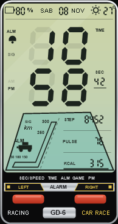
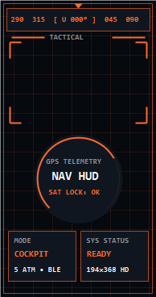
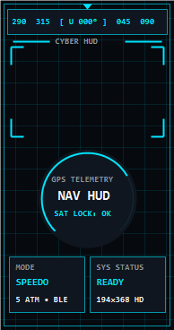
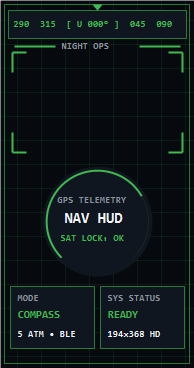

<div align="center">


# Huawei Band 6 • GPS HUD & Retro Car Race Watch Face

**Aplikasi Pendamping Navigasi GPS (Google Maps / Waze), Speedometer Live & Kustomisasi UI Watch Face (`194×368`) untuk Huawei Band 6 / Honor Band 6**

[](https://github.com/pockysman/huawei-band6-gps/releases/latest)
[-3FB950?style=for-the-badge&logo=android)](https://github.com/pockysman/huawei-band6-gps/releases/latest)
[-1F6FEB?style=for-the-badge)](https://github.com/pockysman/huawei-band6-gps/releases/latest)

</div>

---

## 📸 Pratinjau Tampilan Watch Face (`194×368` Piksel)

| **Retro Car Race LCD (`CarRace_GD6_Band6.hwt`)** | **Garmin Tactical Orange** | **Cyber Telemetry Cyan** | **NightOps Radar Green** |
| :---: | :---: | :---: | :---: |
|  |  |  |  |
| *Terinspirasi Casio GD-8 Car Race* | *Gaya Cockpit Aviasi / Taktis* | *Gaya Speedometer F1 / Cyber* | *Gaya Radar Malam Hari* |

---

## 🚀 Unduh Langsung (GitHub Releases)

Silakan unduh file siap pakai melalui halaman **[GitHub Releases Resmi](https://github.com/pockysman/huawei-band6-gps/releases/latest)**:

| File | Kegunaan | Link Unduh |
| :--- | :--- | :---: |
| 📱 **`HuaweiBand6-GPS-HUD-v1.2.apk`** | Aplikasi Android utama (Navigasi GPS, Speedometer, Studio Watch Face & Eksportir `.hwt`) | **[Unduh APK](https://github.com/pockysman/huawei-band6-gps/releases/latest/download/HuaweiBand6-GPS-HUD-v1.2.apk)** |
| ⌚ **`CarRace_GD6_Band6.hwt`** | File Custom Watch Face **Retro Car Race LCD** (`HWHD07` v2.1.1) | **[Unduh .HWT](https://github.com/pockysman/huawei-band6-gps/releases/latest/download/CarRace_GD6_Band6.hwt)** |
| ⌚ **`GPS_Cockpit_Cyan_Band6.hwt`** | File Custom Watch Face **Cyber Telemetry Cyan** (`HWHD07` v2.1.1) | **[Unduh .HWT](https://github.com/pockysman/huawei-band6-gps/releases/latest/download/GPS_Cockpit_Cyan_Band6.hwt)** |

---

## ✨ Fitur Utama

### 1. Smart Notification HUD di Layar Huawei Band 6 (Layar Otomatis Menyala & Bergetar)
Pendekatan utama yang digunakan adalah **Direct Notification HUD** yang diteruskan secara instan oleh Huawei Health ke layar Huawei Band 6:
* **Layar Otomatis Menyala (*Auto-Wake AMOLED*):** Anda tidak perlu repot menggeser (*swipe*) ke menu Kontrol Musik. Layar Huawei Band 6 akan menyala otomatis dan menampilkan jendela *pop-up* di atas Watch Face utama Anda saat instruksi belokan atau peringatan kecepatan tiba.
* **Getaran Pintar Belokan Google Maps & Waze:** Begitu mendekati belokan atau persimpangan (ambang kritis `500m`, `300m`, `200m`, `100m`, `50m`, `20m`), gelang akan bergetar dan menampilkan:
  * **Judul:** `⬅️ 150 m (45 km/j)` *(Arah panah + Jarak belokan + Kecepatan saat ini)*
  * **Isi Pesan:** `Jl. Jend. Sudirman • ETA 14:35 (2.5 km)`
* **Peringatan Batas Kecepatan (*Speed Limit Alert*):** Gelang bergetar instan saat laju kendaraan melewati batas aman (misal `> 80 km/jam`).
* **Bebas Memutar Musik di HP:** Pendekatan notifikasi ini tidak membajak pemutar musik ponsel Anda, sehingga Anda tetap bisa mendengarkan lagu di Spotify atau YouTube di ponsel secara normal selama berkendara!

### 3. Studio Custom Watch Face (`194×368` Piksel) & Integrasi Langsung **HookUtils v1.2.7_p2**
Di dalam aplikasi Android tersedia fitur **HWHD07 Watch Face Studio** yang telah terintegrasi penuh dengan modul **`HookUtils-1.2.7_p2-20240602-R.apk` (`cn.wwl.xposed.hook`)** serta **On-Device `.HWT` Binary Compiler (`HwtCompiler.kt`)**:
* **Metode A — Direct Install `.HWT` via HookUtils / Huawei Health / Gadgetbridge:**
  * Mengompilasi **ke-4 tema HUD** (`01 / Car Race LCD`, `02 / Garmin Tactical`, `03 / Cyber Telemetry`, `04 / NightOps Radar`) secara *on-the-fly* di HP Anda menjadi file biner `.hwt` berformat `HWHD07` (`v2.1.1` RLE BGRA + `model.pb`) lengkap dengan data telemetri GPS terakhir Anda.
  * Menyimpan file `.hwt` ke `/sdcard/Download/`, menyalin lokasinya ke *Clipboard*, dan langsung membuka **Huawei Health** (dengan injeksi WebView HookUtils) atau **Gadgetbridge** untuk dipasang langsung ke Huawei Band 6!
  * APK **Band 6 GPS HUD** ini juga sudah menanamkan modul Xposed/LSPosed/LSPatch **HookUtils v1.2.7_p2** (`MainHook` + `libdexkit.so` + `code.js`) di dalamnya, serta menyertakan tombol **1-Tap Install/Open HookUtils v1.2.7_p2** mandiri.
* **Metode B — Resmi Tanpa Mod via Huawei Health Gallery:**
  * Menyimpan gambar `194×368` bertema **Retro Car Race LCD** (lengkap dengan cetakan data rekor kecepatan maksimum `MAX km/j`, odometer `ODO km`, dan ketinggian `ALT m` dari perjalanan Anda) langsung ke Galeri HP.

---

## 🛠️ Panduan Pemasangan & Penggunaan

### Langkah 1: Konfigurasi Aplikasi Android & Huawei Health
1. Unduh dan instal **[`HuaweiBand6-GPS-HUD-v1.2.apk`](https://github.com/pockysman/huawei-band6-gps/releases/latest/download/HuaweiBand6-GPS-HUD-v1.2.apk)** di HP Android Anda.
2. Buka aplikasi **Band 6 GPS HUD**, lalu berikan izin **Lokasi (GPS)** dan **Notifikasi**.
3. Ketuk tombol biru **"🔔 Berikan Izin Baca Rute Google Maps (Wajib)"**, lalu aktifkan izin untuk **Band 6 Google Maps Reader**.
4. Buka aplikasi **Huawei Health** di HP Anda:
   * Masuk ke menu **Perangkat (Devices)** $\rightarrow$ **Huawei Band 6** $\rightarrow$ **Notifikasi (Notifications)** $\rightarrow$ pastikan izin notifikasi aktif dan centang aplikasi **Band 6 GPS HUD**.
5. Kembali ke aplikasi **Band 6 GPS HUD**, ketuk tombol **"ENGAGE NOTIFICATION HUD"**, lalu ketuk **"TEST WRIST NOTIFICATION"** atau **"SIMULATE MANEUVER"** untuk menguji getaran dan pop-up navigasi di gelang Anda.

### Langkah 2: Memasang Custom Watch Face "Retro Car Race LCD"
* **Cara Resmi (Tanpa Mod/Root):**
  1. Di bagian bawah aplikasi **Band 6 GPS HUD**, ketuk tombol kuning **"💾 SIMPAN WATCH FACE (194×368) KE GALERI HP"**.
  2. Buka aplikasi **Huawei Health** $\rightarrow$ **Perangkat** $\rightarrow$ **Watch Faces** $\rightarrow$ pilih **Gallery (Galeri)**.
  3. Pilih gambar **Car Race LCD** yang baru disimpan, atur posisi jam di area atas, lalu tekan **Save**.
* **Cara File `.HWT` Penuh (Gadgetbridge / Huawei Health Mod):**
  1. Ketuk tombol hijau **"📦 EKSPOR FILE .HWT (CAR RACE LCD) KE DOWNLOAD HP"** di dalam aplikasi (atau unduh [`CarRace_GD6_Band6.hwt`](https://github.com/pockysman/huawei-band6-gps/releases/latest/download/CarRace_GD6_Band6.hwt)).
  2. Buka file `.hwt` tersebut menggunakan **Gadgetbridge** atau fitur *Add Watch Face* pada **Huawei Health Mod**.

---

## 📂 Struktur Repositori

```text
huawei-band6-gps/
├── app/src/main/
│   ├── assets/
│   │   └── CarRace_GD6_Band6.hwt              # Bundel Watch Face .HWT (HWHD07 v2.1.1)
│   ├── java/com/band6/gps/
│   │   ├── MainActivity.kt                    # Dashboard utama, Simulator HUD & Studio Watch Face
│   │   ├── model/GpsNavState.kt               # State repositori GPS, Kompas, Odometer & 4 Mode HUD
│   │   ├── service/BandGpsForegroundService.kt# Pelacak GPS, MediaSession HUD & Notifikasi Getar
│   │   ├── service/MapsNotificationListener.kt# Pembaca arah belokan Google Maps & Waze
│   │   └── util/WatchFaceGenerator.kt         # Renderer Watch Face 194x368 & Eksportir .HWT
│   └── AndroidManifest.xml
├── watchface-hwt-kit/
│   ├── CarRace_GD6_Band6.hwt                  # Watch Face Retro Car Race LCD siap pasang
│   ├── GPS_Cockpit_Cyan_Band6.hwt             # Watch Face Cyber Telemetry Cyan siap pasang
│   ├── CarRace_GD6_preview.png                # Pratinjau Watch Face Car Race LCD
│   ├── gallery-ready-194x368/                 # Koleksi wallpaper Watch Face 194x368 PNG
│   └── tools/build_carrace.ps1                # Kompiler biner RLE BGRA .HWT (HWHD07)
└── release/
    └── HuaweiBand6-GPS-HUD-v1.0.apk           # Salinan APK siap instal
```

---

## 💻 Cara Build dari Kode Sumber (Opsional)

Jika ingin memodifikasi dan mengompilasi ulang proyek ini sendiri:
1. Buka folder proyek di **Android Studio** (mendukung AGP 9.5+ dan Gradle 9.6).
2. Jalankan perintah berikut di terminal:
   ```powershell
   .\gradlew.bat assembleDebug
   ```
3. Untuk mengompilasi ulang file biner `.hwt` Watch Face:
   ```powershell
   powershell -ExecutionPolicy Bypass -File .\watchface-hwt-kit\tools\build_carrace.ps1
   ```
